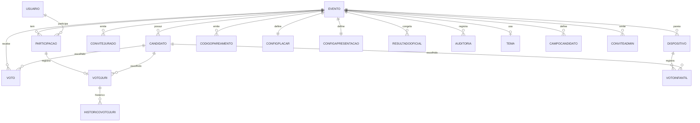
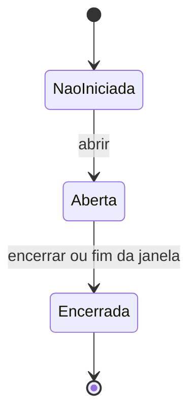

# VaiVota — Design Document

> Versão: 1.2 (planners 1 a 5 consolidados + configuração do evento)
> Revisão 07/10/2026: decisões das revisões 3 e 4 dos planners (ver planners/Contexto.md §11 e §12)
> Stack definida: React/TS + Next.js, Supabase (PostgreSQL), Prisma, Better Auth, Vercel (ver 5.3)
> Fontes: `Login.md`, `Jurado.md`, `VotoInfantil.md`, `ModoApresentacao.md`, `Dashboard.md` e o documento de requisitos original do 9º Festival Ver e Fazer Filmes.
> Funcionalidade 6 (configuração do evento): incorporada na seção 7.6, sem planner separado.
>
> Convenção: itens marcados **[Decidido]** foram definidos em conversa; itens marcados **[Proposta]** são sugestões a validar.

---

## 1. Visão geral

O **VaiVota** é uma plataforma web **white-label** de votação para eventos. Cada evento (um festival de cinema, um torneio de projetos de TI, um campeonato de música, um torneio de jogos) tem sua própria votação, candidatos, regras e identidade visual, usando o mesmo software.

**Primeiros usos:**

| Evento | Quando | Papel |
|---|---|---|
| Demonstração para o Festival | 09/10/2026 | Telas com dados mock, no tema do Festival (inclui totem e voto infantil) |
| Semana Tech (torneio de projetos de TI) | Semana de 18/10/2026 | Primeiro uso real (sistema funcional, dados reais); funciona como ensaio |
| 9º Festival Ver e Fazer Filmes (Cataguases-MG, 25 a 28/nov/2026) | Novembro/2026 | Uso com público maior, voto infantil e foco cinematográfico |

**Direção do produto [Decidido]:** núcleo único com **tema configurável por evento**. O layout e os fluxos são fixos; mudam nome, logo, cores, tipografia, imagens e rótulos. O VaiVota aparece de forma discreta ("powered by"), e o evento parece ser o dono da experiência.

## 2. Objetivos e princípios

**Objetivos**
- Votação popular simples, segura e confiável.
- Voto do júri e voto infantil como módulos opcionais por evento.
- Apresentação cinematográfica do resultado para o telão.
- Dashboard com acompanhamento e exportação dos dados.
- Reutilização entre eventos sem alterar código.

**Princípios** (herdados do documento de requisitos: experiência, confiabilidade e identidade)
1. **Integridade primeiro:** nenhum voto válido duplicado, perdido ou alterado indevidamente.
2. **Sigilo proporcional ao grupo:** voto popular secreto, voto do júri identificado para o admin, voto infantil sem identidade.
3. **Simplicidade para votar:** poucos passos, feedback claro, mobile-first.
4. **Configurável, não customizável:** tema e regras por evento, sem editor visual.
5. **Escopo enxuto:** nada além do necessário para o evento (sem funcionalidades sociais, curtidas ou gamificação).

## 3. Escopo

### 3.1 Funcionalidades

| # | Funcionalidade | Documento |
|---|---|---|
| 1 | Login, registro e votação popular | `Login.md` |
| 2 | Votação do júri | `Jurado.md` |
| 3 | Votação infantil (totens) | `VotoInfantil.md` |
| 4 | Modo apresentação (telão) | `ModoApresentacao.md` |
| 5 | Dashboard e exportação | `Dashboard.md` |
| 6 | Configuração do evento | Seção 7.6 deste documento |

### 3.2 Módulos por evento [Decidido]

| Módulo | Semana Tech | Festival |
|---|---|---|
| Interface personalizada por evento | Sim | Sim |
| Votação popular | Sim | Sim |
| Votação do júri | Sim (voto simples) | Disponível (uso a critério da organização), com voto por critério |
| Votação infantil | Não | Sim |
| Modo apresentação | Sim | Sim |
| Dashboard simples | Sim | Sim |

**Voto infantil e totem [Decidido]:** pareamento, quiosque com PIN, voto infantil e gestão de dispositivos fazem parte do **protótipo** (aparecem na demonstração) e do produto, e entram em uso real no Festival. Têm planner próprio ("Totem", a escrever: mock e depois real).

**Júri [Decidido]:** voto simples na Semana Tech; **voto por critério no Festival** (Direção, Roteiro, Fotografia e Som — documento de requisitos §3.3). Ver seção 7.2.

**Admins adicionais [Decidido]:** por seed; a tela de convite de admin fica para depois.

### 3.3 Fora do escopo desta versão
- Sincronização da apresentação entre várias telas e controle remoto.
- Fila offline de votos nos totens.
- Controles técnicos contra repetição de voto infantil (intervalo mínimo, limite por totem, alertas).
- Armazenamento de vídeo: **nunca** (o trailer é sempre link/embed) **[Decidido]**. Trilha sonora própria.
- Voto por CPF: **descartado** (dado sensível) **[Decidido]**.
- Validação por SMS/OTP: **descartada** (código por e-mail no lugar) **[Decidido]**.
- Tela de convite de admin adicional (admins adicionais entram por seed).
- Geração de PDF no servidor.
- Lista de impedimentos (conflito de interesse) de jurados.
- Painel de super admin e criação de eventos por interface (no início, eventos e primeiro admin são criados por seed/script).
- Duplicar configuração entre eventos (melhoria futura).
- Funcionalidades sociais, comentários e gamificação.

## 4. Atores e papéis

| Ator | Como acessa | O que faz |
|---|---|---|
| **Público** | Conta de usuário (Google ou código por e-mail; sem senha) | Vê candidatos e vota uma vez |
| **Jurado** | Conta de usuário + código de convite individual | Vota (identificado), pode alterar até o fim da urna |
| **Totem (dispositivo)** | Pareado por código; sem conta | Registra votos infantis |
| **Admin do evento** | Conta de usuário com papel de admin | Configura, opera a urna, apresenta, consulta e exporta |
| **Super admin da plataforma** | Sem painel no MVP | Eventos e o primeiro admin são criados por seed/script **[Decidido]**; o painel entra quando houver mais eventos |

**Papéis por evento:** o papel (público, jurado, admin) pertence à **participação** do usuário no evento, não à conta. Um mesmo usuário pode ter papéis diferentes em eventos diferentes.

## 5. Arquitetura

### 5.1 Experiências (frontends)

1. **Pública:** login/registro, lista de candidatos, voto, estados da urna.
2. **Jurado:** mesma interface do público, com resgate de código e voto do júri.
3. **Totem:** modo quiosque em tela cheia (voto infantil).
4. **Admin:** configuração, dashboard, convites, dispositivos e **modo apresentação**.

Todas compartilham dados e regras de negócio; o servidor valida tudo.

### 5.2 Camadas

- **Apresentação:** páginas e componentes React/Next.js, tema por variáveis de design.
- **Aplicação:** regras de votação, autenticação e autorização, controle da urna, apuração, resultado congelado e exportação (route handlers/server actions).
- **Dados:** banco relacional com restrições de unicidade e transações.
- **Infraestrutura:** rate limiting, cache curto, logs estruturados e monitoramento.

### 5.3 Stack [Decidido]

| Item | Escolha | Observação |
|---|---|---|
| Framework | Next.js + TypeScript | **Decidido** |
| Banco | Supabase (PostgreSQL) | **Decidido**. Transações e restrições únicas são essenciais para voto único |
| Acesso a dados | Prisma (ORM com migrações) | **Decidido**. O schema atual ainda está em MySQL; a conversão é tarefa da trilha de produção |
| Autenticação | Better Auth: Google + código por e-mail, **sem senha** | **Decidido**. Evitar implementação própria |
| E-mail | Resend | **Decidido**. Envio do código de login |
| Rate limiting | Por IP e por usuário, no PostgreSQL ou no Upstash Redis | **Decidido** (uma das duas opções) |
| Hospedagem | Vercel | **Decidido**. Serverless: usar pool de conexões do banco |
| Testes de carga | k6 | **Decidido**. Antes de cada evento |
| Monitoramento | Sentry + logs da Vercel | **Decidido**. Separar log técnico de auditoria |

### 5.3.1 Multi-evento (multi-tenancy)
- Todo dado de domínio carrega o **evento** (`eventoId`).
- Um admin só acessa o evento ao qual pertence; eventos não se enxergam.
- URLs por evento: `/e/{slug}`.

### 5.4 Mapa de rotas e telas [Proposta]

| Rota | Quem | Descrição |
|---|---|---|
| `/e/{slug}` | Todos | Entrada do evento com tema, login/registro |
| `/e/{slug}/votar` | Público, jurado | Lista de candidatos, revisão e confirmação |
| `/e/{slug}/convite` | Logado | "Tenho um código de convite" |
| `/e/{slug}/admin` | Admin | Dashboard (abas Operação e Resultado) |
| `/e/{slug}/admin/configuracao` | Admin | Configuração do evento (seção 7.6) |
| `/e/{slug}/admin/apresentar` | Admin | Modo apresentação |
| `/totem/parear` | Dispositivo | Pareamento com código |
| `/totem` | Dispositivo | Modo quiosque de voto infantil |

## 6. Modelo de dados consolidado

### 6.1 Diagrama conceitual



### 6.2 Entidades

| Entidade | Campos principais | Observações |
|---|---|---|
| **Usuario** | id, nome, e-mail, e-mail verificado, criado em | Global; **sem senha**. O método de login fica nas tabelas da biblioteca de autenticação (Better Auth: conta, sessão, verificação), que entram na trilha de produção |
| **Evento** | id, slug, nome, descrição, local, link "sobre", fuso horário, estado, estado da urna, janela de votação, encerramento automático, método de identificação, módulos ativos, aviso de privacidade próprio (opcional), prazo de anonimização | Estado do evento: ver seção 9; configuração: seção 7.6 |
| **Candidato** | id, evento, título, descrição, mídia/imagem, publicado, desqualificado, campos extras | Genérico (filme, projeto, música); campos extras definidos pelo evento; imagem obrigatória para estar na votação |
| **Participacao** | id, usuário, evento, papel, votou | **Único `(usuario, evento)`**; **sem horário** (nem do voto, nem da criação), para não cruzar com o voto |
| **Voto** (popular) | id, evento, candidato, horário, hash de recibo | **Sem referência ao usuário** |
| **ConviteJurado** | id, evento, hash do código, rótulo, validade, estado, participação, resgatado em | Estados: disponível, usado, revogado |
| **VotoJuri** | id, evento, participação, candidato, atualizado em | **Único `(participacao, evento)`**; identificado |
| **HistoricoVotoJuri** | id, voto do júri, candidato anterior, candidato novo, horário | Alimenta auditoria |
| **Dispositivo** | id, evento, nome, hash do token, estado, hash do PIN, criado em, último uso | Estados: ativo, pausado, revogado |
| **CodigoPareamento** | id, evento, hash do código, validade, estado | Uso único |
| **VotoInfantil** | id, evento, candidato, horário, dispositivo | Sem dado da criança |
| **ConfigPlacar** | evento, peso popular, peso júri, peso infantil, regra de desempate | Pesos inteiros (sem decimais) somam 100% |
| **ConfigApresentacao** | evento, link do trailer (YouTube ou Vimeo), usar trailer gerado, incluir candidatos no trailer, classificação completa, modo de avanço, rótulos das categorias, parcial ao vivo, limiar "reta final" | Padrões na seção 8 |
| **Tema** | evento, nome de exibição, logo, paleta, tipografia, capa, rótulos, textos das telas de estado | Contraste validado; fontes pré-aprovadas |
| **CampoCandidato** | evento, rótulo, tipo (texto), ordem | Define os campos extras dos candidatos do evento |
| **ConviteAdmin** | evento, e-mail, estado, resgatado em | Admin adicional entra ao autenticar com o e-mail verificado (tela de convite: depois; no início, admins adicionais por seed) |
| **ResultadoOficial** | evento, calculado em, pesos usados, placares por grupo, pontuação final, posições, categorias, empates e critério | **Congelado** no encerramento; correções geram novo registro |
| **Auditoria** | id, evento, ator, ação, detalhes, horário | Ver seção 10 |

> Requisito do Festival, sem alterar o existente: `Criterio` e `NotaJuri` (participação, candidato, critério, nota) para o voto do júri por critério (seção 7.2). Entram no schema quando os detalhes pendentes forem definidos (seção 17).

### 6.3 Restrições essenciais
- `Participacao`: único `(usuario, evento)`.
- `VotoJuri`: único `(participacao, evento)`.
- Voto popular: marca `Participacao.votou` e grava `Voto` **na mesma transação**, com atualização condicional (`votou = falso`) para impedir duplicidade sob concorrência.
- Códigos e tokens: apenas **hash** no banco.

## 7. Funcionalidades

### 7.1 Votação popular (F1)

**Fluxo:** entrada em `/e/{slug}` → login ou registro → checagem de estado → lista de candidatos → seleção e revisão → confirmação → sucesso.

- **Identificação [Decidido]:** usuário global com participação por evento. Login **sem senha**: Google ou **código enviado por e-mail** (o código confirmado verifica o e-mail). Não há recuperação de senha. Só e-mail verificado vota. Método configurável por evento (por seed).
- **Estados:** urna não iniciada, encerrada, "já votou" e aberta.
- **Candidatos:** apenas publicados, em **ordem embaralhada por usuário**, estável durante a sessão.
- **Voto:** irrevogável, um por usuário por evento, com revisão antes de confirmar.
- **Erros tratados:** duplo clique e reenvio (idempotência), queda de rede na confirmação, urna fechada durante a confirmação, link direto com urna fechada, nenhum candidato publicado.
- **Sigilo [Decidido]:** quem votou (`Participacao`) e em quem votou (`Voto`) ficam desvinculados.
- **Voto em si mesmo [Decidido]:** candidato vinculado a um usuário não vota em si mesmo (bloqueado por padrão, configurado por seed).

### 7.2 Votação do júri (F2)

**Fluxo:** registro com switch **Jurado** + código → participação com papel `jurado` → mesma tela de voto, sem contagens → confirmação → alteração permitida enquanto a urna estiver aberta.

- **Convites [Decidido]:** códigos **individuais, de uso único**, gerados em lote pelo admin (n jurados), com rótulo opcional, validade, revogação e exportação em CSV. Só o hash fica no banco; o código aparece uma vez.
- **Resgate:** no registro ou, para quem já tem conta, em "Tenho um código de convite". Quem já votou como público no evento **não pode** resgatar.
- **Voto [Decidido]:** **simples** (um candidato) na Semana Tech; **por critério** no Festival (Direção, Roteiro, Fotografia e Som), com `Criterio` e `NotaJuri`. Detalhes pendentes: escala da nota, peso por critério, como a nota vira placar do júri (proposta: placar do júri do candidato = soma das médias dos critérios dadas pelos jurados, normalizada como os outros grupos) e desempate por critério.
- **Sigilo [Decidido]:** voto **identificado para o admin**, com histórico de alterações; **nunca** exibido no telão (o telão mostra só o vencedor da categoria). Jurados devem ser **informados** de que o voto é identificado.
- **Painel do jurado:** sem contagens (evita viés).
- **Urna:** mesma urna e mesma janela do público.

### 7.3 Votação infantil (F3)

**Fluxo:** admin gera código de pareamento → totem é pareado → modo quiosque ("Toque para votar") → seleção → confirmação em duas etapas → sucesso → retorno automático.

- **Totem [Decidido]:** dispositivo pareado (token de longa duração, só hash no banco), com estado ativo, pausado ou revogado, nome e **PIN de saída do quiosque**.
- **Dados [Decidido]:** candidato, horário e dispositivo; nenhum dado da criança.
- **Integridade [Decidido]:** mediador adulto por totem e pesos na fórmula; nenhum controle técnico adicional agora.
- **Placar [Decidido]:** próprio, "Escolha das Crianças", **e** peso na fórmula final.
- **Módulo opcional** por evento; entra no protótipo (demonstração) e em uso real no Festival, com planner próprio "Totem".

### 7.4 Modo apresentação (F4)

**Fluxo:** o admin abre a tela, espelha ou estende no telão e clica em **Apresentar**. A tela corresponde ao estado do evento:

1. Antes da votação: nome, logo, candidatos e contagem.
2. Votação aberta: cards, **QR Code**, temporizador (hora do servidor) e **total geral**.
3. Encerrada: "Votação encerrada", aguardando o admin.
4. Revelação (sequência abaixo).
5. Resultado final estático.

**Sequência da revelação [Decidido]:** trailer do evento → **Queridinho do público** (mais votado pelo público geral) → **Preferido das crianças** → **Escolha dos jurados** → **pódio** com pontuação final (3º, 2º, 1º) → classificação completa (opcional, desligada por padrão).

- **Categorias [Decidido]:** mostram **só o candidato vencedor** (com a quantidade de votos ou a pontuação dele). **Nunca** se mostra quem votou em quem.
- **Trailer [Decidido]:** um só para o evento, por **link/embed (YouTube ou Vimeo)**; **nunca se armazena vídeo**; não existe trailer por candidato. Fallback para trailer gerado no navegador com a identidade do evento; pular a qualquer momento.
- **Empates [Decidido]:** revelados ao vivo, com animação que mostra o critério e destaca o vencedor do desempate. Se persistir, a posição é compartilhada.
- **Operação:** tela cheia com atalhos de teclado, modo de avanço automático ou manual, **modo ensaio** com dados simulados, botão de emergência para o resultado estático e pré-carregamento de mídia.
- **Aviso:** ao espelhar, tudo o que o admin faz vai para o telão; recomenda-se estender a tela.
- **Segurança:** o resultado só chega ao admin autenticado, depois do encerramento.

### 7.5 Dashboard e exportação (F5)

- **Abas [Decidido]:** **Operação** (ao vivo) e **Resultado** (após o encerramento).
- **Operação:** estado da urna, tempo restante, totais por grupo, votos por minuto, participantes, jurados pendentes, totens, códigos de jurado e resumo de auditoria. **Sem votos por candidato** durante a votação (opção por evento).
- **Resultado:** o resultado oficial congelado (mesma fonte do telão).
- **Exportação [Decidido]:** CSVs (`resumo_evento`, `resultado_candidatos`, `votos_por_minuto`, `jurados`, `dispositivos`, `auditoria`) e relatório imprimível (PDF pelo navegador). Sem e-mails; votos identificados do júri só para o admin; toda exportação é auditada.
- **Desempenho:** consultas agregadas com cache curto e polling a cada poucos segundos.

### 7.6 Configuração do evento (F6)

**Objetivo:** permitir que o admin prepare, opere e conclua o evento sem alterar código.

**Criação do evento [Decidido]:** no início, o evento e o primeiro admin são criados por **seed/script**. Não há painel de super admin no MVP; ele entra quando houver mais eventos.

**Admins adicionais [Decidido]:** por **seed**. A tela de convite (o admin cadastra o e-mail da pessoa; ao entrar com esse e-mail verificado, ela recebe o papel de admin do evento, via `ConviteAdmin`) fica para depois.

**Seções da tela de configuração [Proposta]**

| Seção | O que configura |
|---|---|
| **Geral** | Nome, slug da URL, descrição, datas, fuso horário |
| **Módulos** | Júri e infantil ligados ou desligados (apresentação e dashboard sempre existem) |
| **Votação** | Janela de início e fim, encerramento automático ao fim da janela, método de identificação, regra de candidato votar em si mesmo |
| **Candidatos** | Cadastro, edição, publicar e despublicar, imagem/cartaz (obrigatória para colocar na votação; opcional no rascunho), campos extras |
| **Júri** | Quantidade, geração de convites em lote, validade, revogação |
| **Infantil** | Dispositivos, códigos de pareamento, PIN do quiosque |
| **Placar** | Três pesos inteiros (somando 100%), regra de desempate |
| **Apresentação** | Trailer (link/embed), rótulos das categorias, classificação completa, modo de avanço |
| **Tema** | Nome de exibição, logo, cores, tipografia, capa, rótulos, textos das telas de estado |
| **Privacidade** | Aviso de privacidade próprio do evento (opcional, complementar ao da plataforma) e prazo de anonimização |
| **Operação** | Abrir urna, encerrar urna, Concluir Evento |

**Campos extras de candidato [Proposta]:** título, descrição e imagem são obrigatórios; o evento define alguns campos extras de texto com seu próprio rótulo (ex.: "Direção" e "Duração" em um festival de cinema; "Equipe" e "Tecnologias" em um torneio de TI).

**Tema com limites [Proposta]:** a paleta passa por **checagem automática de contraste**, a tipografia vem de uma lista de **fontes pré-aprovadas**, e uma **pré-visualização** mostra login, votação e telão antes de salvar.

**Checklist de ativação (Rascunho → Ativo) [Proposta]**
- Pelo menos 2 candidatos publicados.
- Pesos somando 100%, considerando só os módulos ligados.
- Janela de votação válida.
- Júri ligado: convites gerados.
- Infantil ligado: ao menos um totem pareado (aviso, não bloqueio).
- Tema com contraste aprovado.
- Trailer testado (aviso).

**O que muda depois que a urna abre [Decidido]** (trava total dos pesos e do desempate no MVP; alteração auditada com a urna aberta é evolução futura. Método de identificação é configurado por seed)

| Situação | O que se aplica |
|---|---|
| **Trava total** | Módulos, pesos, regra de desempate, método de identificação; adicionar, remover ou despublicar candidatos |
| **Permitido com auditoria** | Estender o fim da janela, pausar ou revogar totens, revogar convites, corrigir texto ou imagem de um candidato |
| **Livre** | Tema, trailer, rótulos e opções da apresentação |

**Imagem do candidato [Decidido]:** obrigatória para colocar o candidato na votação; opcional enquanto ele estiver em rascunho.

**Ação excepcional: desqualificar candidato [Decidido]:** se um candidato precisar sair depois de receber votos, a ação auditada (irreversível) o marca como desqualificado e o retira **da votação e do ranking**, **mantendo os votos no banco** (eles entram na contagem bruta, não na base da fórmula; ver 8.1); o resultado oficial é recalculado como novo registro.

**Versão mínima (MVP) [Decidido em parte]:** Geral, Candidatos, Júri (convites), Placar, Tema básico (nome, logo e cores) e Operação; o restante é configurado por seed.

**Futuro:** painel de super admin, duplicar configuração entre eventos (atende o requisito de reutilização), campos extras mais ricos.

## 8. Apuração e resultado

### 8.1 Fórmula [Decidido]

```
pontuação(candidato) =
    peso_popular   × (votos_populares ÷ total_popular)
  + peso_juri      × (votos_juri      ÷ total_juri)
  + peso_infantil  × (votos_infantis  ÷ total_infantil)
```

- Cada grupo é **normalizado** antes de aplicar o peso.
- Os pesos são inteiros e somam 100%; grupo desativado no evento entra com peso 0.
- **Base sem desqualificados [Decidido]:** os totais de cada grupo (`total_popular`, `total_juri`, `total_infantil`) não incluem votos de candidatos desqualificados; esses votos continuam na contagem bruta.
- **Grupo sem votos [Decidido]:** grupo ligado com base 0 tem o peso **redistribuído** proporcionalmente entre os grupos com base > 0: `pesoEfetivo[g] = peso[g] × 100 ÷ soma dos pesos dos grupos com base > 0`. Se todos os grupos estiverem sem votos, todas as pontuações são 0.
- Os **placares por grupo** ficam sempre disponíveis, além da pontuação final.
- Votos rejeitados ou bloqueados não são contabilizados.

### 8.2 Desempate [Decidido]
- Ranking final: critério configurável por evento (maior votação do **júri** ou do **público**).
- Se o desempate também empatar: posição compartilhada, sem decisão automática.
- Categorias (queridinho, preferido, escolha): desempate pela pontuação final; se persistir, co-vencedores.

### 8.3 Resultado oficial congelado
- Gerado no **encerramento da urna** e não recalculado depois.
- Contém pesos usados, placares por grupo, pontuação final, posições, categorias, empates e critério aplicado.
- Telão, dashboard e exportação leem a **mesma fonte**.
- Correções só por ação administrativa auditada, com novo registro.

### 8.4 Configurações de apresentação (padrões) [Proposta]
- Classificação completa: desligada.
- Votos por candidato ao vivo: desligado.
- Trailer gerado sem candidatos.
- Modo de avanço: automático com pausa disponível.

## 9. Estados do sistema

### 9.1 Ciclo de vida do evento [Proposta]
`Rascunho → Ativo → Concluído`

- **Rascunho:** em configuração; nada é público. A passagem para **Ativo** exige o checklist da seção 7.6.
- **Ativo:** a votação opera conforme o estado da urna.
- **Concluído:** ação **Concluir Evento** do admin, depois da apresentação do resultado.
  - Bloqueia novas votações (popular, júri e totens).
  - Papéis de jurado permanecem como histórico (**não** são convertidos em público).
  - Dashboard em somente leitura, com exportações.

### 9.2 Estados da urna [Decidido]



- A urna só aceita votos quando **Aberta**.
- Encerrar bloqueia todos os votos de imediato.
- A hora do servidor é a referência para janela e temporizador.
- O encerramento automático ao fim da janela é configurável (seção 7.6); encerrar manualmente é sempre possível.
- Reabertura não é prevista no MVP **[Decidido]**; se um dia for necessária, será uma ação excepcional auditada.

## 10. Segurança, privacidade e auditoria

### 10.1 Sigilo por tipo de voto

| Voto | Quem pode saber em quem votou | Motivo |
|---|---|---|
| Popular | Ninguém (sem vínculo no banco) | Sigilo do voto |
| Júri | Admin do evento (identificado) | Júri pequeno; permite auditar contestações |
| Infantil | Ninguém (sem identificação da criança) | Não coletar dados de crianças |

### 10.2 Controles
- Validações **sempre no servidor** (estado da urna, papel, unicidade, dispositivo).
- Rate limiting em login, registro, resgate de código, pareamento e voto.
- **Sem senha [Decidido]:** login só por Google ou código por e-mail; nenhuma senha é guardada.
- Códigos e tokens apenas como hash; revogação imediata.
- Mensagens de erro genéricas ao usuário; detalhes só no log técnico.
- Credenciais de admin individuais e mínimo privilégio; abrir e encerrar a urna exigem permissão de admin.
- Resultado e votos identificados só para admin autenticado.

### 10.3 Auditoria
Registrar: abertura e encerramento da urna; geração, resgate e revogação de códigos; pareamento, pausa e revogação de dispositivos; alteração de pesos e configuração; alterações de voto do júri; bloqueios por rate limit; revelação e recálculo de resultado; exportações; conclusão do evento. **Separar** logs técnicos dos registros de auditoria.

### 10.4 Privacidade e LGPD [Proposta]
- **Controladora dos dados [Decidido]:** a **VaiVota**. O aviso de privacidade é **da plataforma VaiVota** (um texto único, com link no registro e no rodapé); o aviso próprio do evento (`Evento.avisoPrivacidadeUrl`) é opcional e complementar. Texto do aviso pendente (rascunho a partir desta seção).
- Coletar o mínimo (nome, e-mail); informar finalidade no aviso de privacidade.
- Informar os jurados de que o voto é identificado ao admin.
- Exportações trazem apenas contagens de participantes, sem e-mails.
- **Retenção [Decidido]:** após **Concluir Evento**, nome e e-mail dos participantes são **anonimizados** depois de um prazo configurável por evento (sugestão: 90 dias), mantendo participações e votos para a integridade do resultado. O admin exporta o que precisar antes.

## 11. Desempenho, confiabilidade e operação

- **Pico:** concentração de votos logo após as sessões e a revelação. Registrar o voto deve ser leve (transação curta) e idempotente.
- **Dashboard e apresentação** usam agregações com cache curto, sem competir com o registro de votos.
- **Teste de carga** antes de cada evento, com cenários de usuários simultâneos, observando latência, taxa de erro, throughput e comportamento do banco.
- **Observabilidade:** logs estruturados, monitoramento de erros e disponibilidade, indicadores de operação durante a votação.
- **Backups** do banco antes do evento e procedimento de recuperação.
- **Contingência:** plano para indisponibilidade temporária, sem dupla contagem; responsável com acesso admin disponível no dia; ensaio completo da apresentação no modo ensaio.
- **Rede no evento:** conectividade estável para o telão e para os totens (fila offline fica para depois).

## 12. Acessibilidade, responsividade e identidade visual

- **Mobile-first** (votação por QR Code), com tablets nos totens e 16:9 para telão (1080p e 4K).
- **Equipamentos-alvo [Decidido]:** Semana Tech — telão, celulares e computadores (o voto também acontece em computador); Festival — telão, celulares e totens.
- Contraste adequado, tipografia legível, foco visível, áreas de toque amplas, navegação por teclado e leitores de tela.
- Informação nunca só por cor ou animação; texto e ícones acompanham os estados.
- Respeitar `prefers-reduced-motion`; animações mais expressivas apenas no modo apresentação.
- **Interface infantil:** poucos elementos, cartazes grandes, mínimo de texto, feedback imediato.
- **Tema por evento:** nome, logo, paleta, tipografia, imagem de capa e rótulos (ex.: "filme", "projeto", "música"; nomes das categorias do telão), via variáveis de design. Sem layouts diferentes por evento.

## 13. Plano de entrega [Decidido]

Quatro fases **sequenciais**:

| Fase | Quando | Escopo |
|---|---|---|
| **1. Demonstração** | 09/10/2026 | Telas com dados mock, no tema do Festival |
| **2. Semana Tech** | Semana de 18/10/2026 | Uso real (sistema funcional, dados reais) |
| **3. Festival** | 25 a 28/11/2026 | Uso real |
| **4. Final** | Depois do Festival | Restante das funcionalidades |

Uma funcionalidade entregue numa fase não é reimplementada na seguinte. O conteúdo de cada fase será definido na reestruturação dos planners.

**Redução de risco [Decidido]:** no primeiro evento, o evento e o primeiro admin são criados por **seed/script** (sem painel de super admin). A tela de configuração do MVP cobre só **Geral, Candidatos, Júri (convites), Placar, Tema básico e Operação**; o restante é configurado por seed e entra na fase seguinte (ver 7.6).

## 14. Critérios de aceitação consolidados

**Votação popular**
- [ ] Usuário se registra (nome e e-mail, sem senha), confirma o código recebido por e-mail, vota em poucos passos e vê a confirmação.
- [ ] Login por Google ou por código por e-mail; não existe campo de senha nem recuperação de senha.
- [ ] Segundo voto é impedido, inclusive com requisições simultâneas.
- [ ] Com a urna fechada ou não iniciada, não é possível votar, nem por link direto.
- [ ] Não existe vínculo entre usuário e candidato escolhido.
- [ ] A ordem dos cards varia entre usuários.

**Júri**
- [ ] Admin gera n códigos individuais e baixa a lista; código usado ou revogado é rejeitado.
- [ ] Quem já votou como público não resgata código.
- [ ] Jurado vota, altera até o fim da urna e o histórico fica registrado.
- [ ] O painel do jurado não exibe contagens.
- [ ] O voto do júri nunca aparece no telão.
- [ ] Festival: o jurado dá notas por critério (Direção, Roteiro, Fotografia e Som) (critério detalhado quando as pendências da seção 17 forem definidas).

**Voto infantil**
- [ ] Totem é pareado, vota com confirmação em duas etapas e volta ao início sozinho.
- [ ] Sair do quiosque exige PIN; totem pausado ou revogado não aceita votos.
- [ ] O voto guarda candidato, horário e dispositivo, sem dado pessoal.

**Apresentação**
- [ ] A tela corresponde ao estado do evento; ao vivo mostra cards, QR Code, temporizador e total geral.
- [ ] A revelação segue a ordem definida e pula categorias sem módulo.
- [ ] Empates aparecem com critério e destaque; empate persistente vira posição compartilhada.
- [ ] As categorias mostram só o vencedor; nunca quem votou em quem.
- [ ] O trailer é sempre link/embed (nenhum vídeo armazenado) e cai no gerado se o link falhar; modo ensaio e botão de emergência funcionam.
- [ ] Nenhum dado de resultado chega ao navegador antes da revelação.

**Dashboard e exportação**
- [ ] Durante a votação, não aparecem votos por candidato.
- [ ] Os números do dashboard e do telão batem (resultado congelado).
- [ ] Exportações geram os CSVs sem e-mails; a exportação do júri é restrita e auditada.
- [ ] Evento concluído abre em somente leitura.

**Configuração do evento**
- [ ] Evento e primeiro admin criados por seed/script e acessíveis em `/e/{slug}/admin`.
- [ ] Admin cadastra candidatos com campos extras definidos pelo evento; sem imagem, o candidato só fica em rascunho.
- [ ] Desqualificar um candidato o tira da votação e do ranking, mantém os votos e gera novo resultado oficial.
- [ ] Grupo ligado sem votos tem o peso redistribuído entre os demais.
- [ ] O tema é aplicado e a paleta é validada por contraste.
- [ ] A ativação do evento exige o checklist (candidatos, pesos, janela).
- [ ] Depois que a urna abre, módulos, pesos, desempate, identificação e lista de candidatos ficam travados.
- [ ] Mudanças permitidas após a abertura ficam auditadas.

**Transversais**
- [ ] O tema do evento aparece em login, votação, totem e apresentação.
- [ ] Interfaces utilizáveis em celular, com foco visível e navegação por teclado.
- [ ] O sistema suporta o teste de carga definido para o cenário esperado.
- [ ] Ações administrativas relevantes ficam auditáveis.

## 15. Riscos e mitigações

| Risco | Mitigação |
|---|---|
| Pico de votos após as sessões | Transação curta, idempotência, cache curto no dashboard, teste de carga |
| Contas falsas | Google ou código por e-mail, rate limiting, restrição única por evento |
| Código de jurado vazado | Códigos individuais, uso único, validade, revogação, auditoria |
| Resultado vazando por espelhamento da tela | Atalhos de teclado, tela cheia, recomendação de estender a tela, dados só após a revelação |
| Voto infantil repetido | Mediador adulto, pesos na fórmula, dados de dispositivo e horário para análise posterior |
| Falha de internet no evento | Plano de contingência, conectividade testada, resultado congelado, botão de emergência |
| Totem perdido ou comprometido | Revogação imediata e PIN de saída |
| Animações pesadas travam no telão | Pré-carregamento, modo ensaio, resultado estático de emergência |
| Escopo e prazo curto | Fases, seed para o primeiro evento, configuração mínima |
| Contestação do júri | Voto identificado, histórico de alterações, auditoria |
| Dados pessoais | Coleta mínima, aviso de privacidade, retenção configurável |
| Mudança de configuração com votos registrados | Trava de módulos, pesos, desempate e candidatos ao abrir a urna; alterações permitidas auditadas |
| Tema com baixo contraste ou ilegível | Validação automática de contraste, fontes pré-aprovadas e pré-visualização |

## 16. Decisões registradas

1. VaiVota é **white-label**: núcleo único com tema por evento.
2. Stack: **React/TS + Next.js**, **Supabase (PostgreSQL)**, **Prisma**, **Better Auth**, **Vercel**, **Resend**, rate limiting no PostgreSQL ou Upstash Redis, **Sentry** + logs da Vercel, k6 para carga (seção 5.3).
3. Conta global + **participação por evento** com papel; login **sem senha**: Google ou código por e-mail.
4. Voto popular único (restrição no banco), irrevogável, sem vínculo com o usuário; ordem embaralhada.
5. Júri: convites individuais de uso único em lote; **voto simples na Semana Tech; por critério no Festival**; **identificado** ao admin, nunca exibido no telão; alterável até o fim da urna.
6. Placar por **percentual ponderado** com três pesos (popular, júri, infantil), configuráveis; desempate configurável (júri ou público).
7. Infantil: totem como **dispositivo pareado**; placar próprio "Escolha das Crianças" **e** peso; mediador adulto; fila offline depois.
8. Apresentação **só do admin**, local; trailer único do evento; revelação por categorias, pódio e empates ao vivo; classificação completa opcional.
9. Dashboard em **duas abas**; sem votos por candidato durante a votação; exportação sem e-mails.
10. **Resultado oficial congelado** no encerramento, fonte única para telão, dashboard e exportação.
11. "Concluir Evento" bloqueia votos e mantém o histórico de papéis.
12. Eventos e o primeiro admin são criados por **seed/script**; **sem painel de super admin** por enquanto.
13. A configuração do evento segue a estrutura da seção 7.6 (seções, checklist, travas, retenção); itens marcados como [Proposta] seguem sujeitos a revisão.
14. Imagem obrigatória para colocar o candidato na votação; desqualificado sai da votação e do ranking, com votos mantidos na contagem bruta e fora da base da fórmula.
15. Grupo ligado sem votos: peso **redistribuído** entre os grupos com votos; todos sem votos → pontuações 0. Pesos inteiros, travados ao abrir a urna.
16. Categorias da revelação mostram só o vencedor; o voto do júri nunca vai ao telão. Trailer único do evento, só por link/embed; nunca se armazena vídeo.
17. Voto infantil e totem entram no protótipo (demonstração) e no Festival, com planner próprio.
18. Admins adicionais por seed; voto por CPF e validação por SMS/OTP descartados.
19. Controladora dos dados: **VaiVota**; aviso de privacidade da plataforma, com aviso do evento opcional e complementar.
20. Entrega em quatro fases sequenciais: Demonstração, Semana Tech, Festival e Final (seção 13).

## 17. Pendências consolidadas

**Em aberto**
- Número esperado de votantes por evento e pico (para dimensionar os testes de carga).
- Detalhes do voto do júri por critério (Festival): escala da nota, peso por critério, como a nota vira placar do júri (proposta: soma das médias dos critérios dadas pelos jurados, normalizada como os outros grupos) e desempate por critério.
- Texto do aviso de privacidade da plataforma (rascunho a partir da seção 10.4).
- Textos finais e ilustrações das telas de estado e do totem (catálogo único de textos, revisado com a organização).
- Direção visual das animações (incluindo o efeito de desempate), a revisar no ensaio.

**Resolvidas (revisões 3 e 4 dos planners)**
- Candidato que também é participante votar em si mesmo: bloqueado por padrão, configurado por seed.
- Grupo ativo sem nenhum voto: peso redistribuído (seção 8.1).
- Reabertura da urna: não prevista no MVP.
- Jurado ver o próprio voto depois do evento: não.
- Desqualificação: votos preservados, fora da votação e do ranking, novo resultado oficial (seção 7.6).
- Admins adicionais: por seed; tela de convite depois.
- Prazo de anonimização: 90 dias.
- Fontes pré-aprovadas: lista configurável, personalizada pelo dono do produto; contraste conferido automaticamente.
- Stack técnica (ORM, autenticação, banco, hospedagem, e-mail, rate limiting, monitoramento): seção 5.3.
- Formato dos CSVs: UTF-8 com BOM, separador `;`, quebra CRLF; colunas e layout do relatório imprimível definidos no planner do dashboard (Etapa 7).
- Modo de avanço padrão da apresentação: automático com pausa; durações das etapas definidas nos planners e ajustadas no ensaio.

**Futuro**
- Painel de super admin e duplicar configuração.
- Tela pública de resultado estático após o evento.

## 18. Glossário

- **Evento:** uma votação com seus candidatos, regras, tema e participantes.
- **Candidato:** item votado (filme, projeto, música, jogo).
- **Urna:** controle que determina quando se pode votar (não iniciada, aberta, encerrada).
- **Participação:** vínculo de um usuário com um evento, com papel e indicação de que votou.
- **Placar:** contagem de votos de um grupo (popular, júri ou infantil).
- **Pontuação final:** resultado da fórmula ponderada que define o ranking.
- **Resultado oficial:** cálculo congelado no encerramento, fonte única de telão e exportação.
- **Totem:** dispositivo pareado para voto infantil.
- **Convite:** código individual de uso único que habilita o registro como jurado.
- **Modo ensaio:** execução da apresentação com dados simulados.
