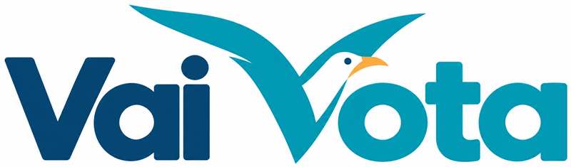
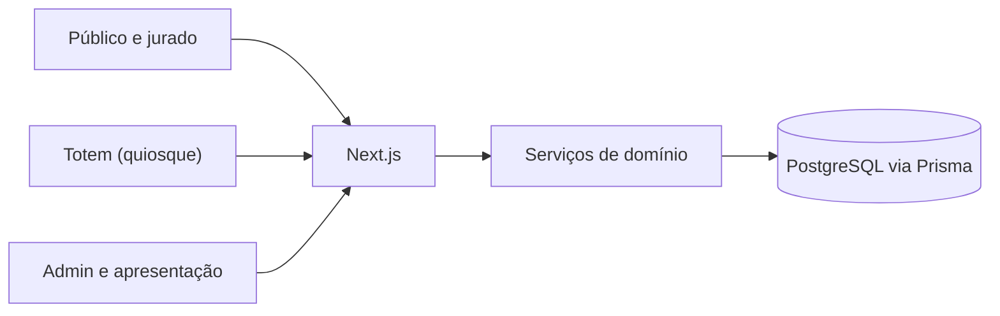

<p align="center"></p>

# VaiVota

Plataforma web **white-label de votação para eventos**. Um mesmo software atende festivais, torneios e campeonatos: cada evento tem seus candidatos, regras e identidade visual, sem alterar código.

> **Status:** o **MVP da Semana Tech** está implementado com dados reais (PostgreSQL/Supabase, Better Auth, upload de imagens, votação, operação, apuração, painel, exportação). O que falta é a configuração do ambiente (variáveis, domínio, e-mail, Google): ver [`docs/SEMANA-TECH-IMPLANTACAO.md`](docs/SEMANA-TECH-IMPLANTACAO.md). O protótipo da Fase 1 (Etapas 0 a 9) segue no código para o MVP do Festival. Ver [`docs/`](docs/).

---

## Sumário

- [MVP Semana Tech (dados reais)](#mvp-semana-tech-dados-reais)
- [Fase 1 — protótipo (sem banco)](#fase-1--protótipo-sem-banco)
- [O que é](#o-que-é)
- [Recursos](#recursos)
- [Conceitos](#conceitos)
- [Princípios de design](#princípios-de-design)
- [Stack](#stack)
- [Arquitetura](#arquitetura)
- [Modelo de dados](#modelo-de-dados)
- [Primeiros passos](#primeiros-passos)
- [Variáveis de ambiente](#variáveis-de-ambiente)
- [Estrutura do projeto](#estrutura-do-projeto)
- [Segurança e privacidade](#segurança-e-privacidade)
- [Documentação](#documentação)
- [Roadmap](#roadmap)
- [Licença](#licença)

## MVP Semana Tech (dados reais)

Plano completo em [`MVP-SemanaTech.md`](MVP-SemanaTech.md). Único objetivo do evento: **apurar os votos do público de 8 projetos**. Voto único garantido no banco, voto secreto, sem parcial por projeto, urna só abre e fecha pela organização, resultado oficial congelado no encerramento.

| Peça | Como é |
|---|---|
| Banco | PostgreSQL (Supabase), Prisma 7, migração em `prisma/migrations` (com os CHECKs), seed idempotente |
| Autenticação | Better Auth: e-mail e senha com **código por e-mail** (Resend; plano B SMTP) para verificar e recuperar a senha, mais Google. Bloqueio de 5 senhas erradas e limites por e-mail |
| Servidor | `src/server/**`: serviços com as mesmas assinaturas do protótipo, chamados por `POST /api/servico/<nome>` (`src/server/rpc.ts`). `src/dominio/**` (apuração, travas, exportação) é o mesmo código do protótipo |
| Navegador | O mesmo `EstadoApp` do protótipo, preenchido com o **estado público** que o servidor entrega (evento, tema, candidatos publicados, a própria pessoa), com polling (10 s para quem espera a urna, 30 s para quem já votou, 60 s com a urna encerrada). Nunca chegam votos, auditoria nem e-mails de terceiros |
| Imagens | Supabase Storage (bucket público, escrita só pelo servidor); PNG, JPG ou WebP até 2 MB, conferidos no servidor |
| Fora do MVP | Júri, voto infantil, totem, modo apresentação e a galeria de dev: rotas com 404 (`NEXT_PUBLIC_MODULOS_FESTIVAL=false`); o código fica para o Festival |

### Como rodar (desenvolvimento)

```bash
pnpm install
pnpm db:local                          # PostgreSQL embutido + migração + seed (deixe rodando)
cp .env.example .env.local             # preencha: DATABASE_URL, DIRECT_URL, BETTER_AUTH_SECRET, APP_URL; EMAIL_PROVIDER=console
pnpm db:promover-admin seu@email.com   # o primeiro admin
pnpm dev                               # http://localhost:3000/e/semana-tech
```

| Comando | Para quê |
|---|---|
| `pnpm test` | Testes unitários (domínio, lib, estado real, cliente do servidor) |
| `pnpm test:integracao` | Testes do servidor contra um PostgreSQL **real** embutido (voto único com concorrência, encerramento durante rajada, login, operação, painel, segurança) |
| `pnpm lint` · `pnpm typecheck` · `pnpm build` | Verificações |
| `pnpm db:migrar` · `pnpm db:seed` · `pnpm db:promover-admin <e-mail>` | Banco real (ver implantação) |
| `pnpm db:backup --rotulo antes-da-urna` | Backup com `pg_dump` |
| `pnpm db:limpar-ensaio --confirmar` | Limpa os dados do ensaio antes do evento |
| `pnpm db:carga-preparar` · `k6 run tests/carga/votar.js` · `pnpm db:carga-conferir` | Teste de carga e conferência de integridade |

Implantação (Supabase, Vercel, domínio, Resend, Google): [`docs/SEMANA-TECH-IMPLANTACAO.md`](docs/SEMANA-TECH-IMPLANTACAO.md). Dia do evento e contingência: [`docs/SEMANA-TECH-DIA-DO-EVENTO.md`](docs/SEMANA-TECH-DIA-DO-EVENTO.md).

## Fase 1 — protótipo (sem banco)

> O texto abaixo descreve o protótipo da Fase 1, que continua no repositório. No MVP da Semana Tech ele roda com dados reais (seção acima): sem relógio simulado, sem toolbar, sem contas seed e sem `123456`.

O protótipo navegável roda **só no navegador**: todo o estado fica em memória (store no layout raiz). **As abas do mesmo navegador ficam sincronizadas** (`BroadcastChannel`): o palco da apresentação abre numa aba própria, que vai para o telão, enquanto o admin opera na outra; F5 ou uma aba nova com outra aberta recuperam o estado, e **fechar todas as abas volta ao seed**. A navegação entre telas preserva o estado. Todas as etapas da Fase 1 estão implementadas (0 a 9). O que é fake, a fronteira de dados e o roteiro de demonstração estão em [`docs/`](docs/).

### Como rodar

```bash
pnpm install
pnpm dev          # http://localhost:3000
pnpm lint
pnpm typecheck    # next typegen + tsc --noEmit
pnpm test         # Vitest (só src/dominio e src/lib)
pnpm build
```

Copie `.env.example` para `.env.local` se quiser mudar a flag `NEXT_PUBLIC_DEV_TOOLBAR` (padrão `true`; `false` remove a toolbar e a galeria `/dev/ui` do build).

### Rotas

| Rota | Tela |
|---|---|
| `/` | Landing do VaiVota, com a lista de eventos publicados |
| `/e/ver-e-fazer-filmes` | Landing do evento: status, hero, acesso (entrar / criar conta), como funciona e a votação (lista, detalhe, revisão e sucesso em modais; visitante vê a lista e entra para ver detalhes) |
| `/e/[slug]/recuperar-senha` | Esqueci minha senha: e-mail → código → senha nova |
| `/e/[slug]/verificar-email` | Confirmação de e-mail por código (só para sessão sem e-mail verificado; alcançável pela toolbar) |
| `/e/[slug]/convite` | "Tenho um código de convite" (exige e-mail verificado) |
| `/e/[slug]/votar` | Só redireciona para a votação na entrada (`/e/[slug]#candidatos`), para links antigos |
| `/e/[slug]/avaliar/[candidatoId]` | Avaliação por critério de um candidato: só jurado, com a urna aberta e o júri em "Notas por critério" ou "Melhor por critério" |
| `/e/[slug]/admin` | Painel: abas Operação e Resultado, exportação CSV (exige `ADMIN` no evento) |
| `/e/[slug]/admin/configuracao` | Configuração do evento (seções Geral, Candidatos, Júri, Placar, Tema, Operação) |
| `/e/[slug]/admin/relatorio` | Relatório imprimível (só com resultado oficial) |
| `/e/[slug]/admin/apresentar` | Sala de controle da apresentação (real e ensaio). **Apresentar** abre o palco na aba do telão |
| `/e/[slug]/admin/apresentar/palco` | Palco do telão, numa aba própria (uma só, reaproveitada) e sincronizada com a do admin; um clique entra em tela cheia; depois é comandado pelo **controle remoto**, que flutua em todas as telas do admin enquanto o telão estiver aberto (avançar, voltar, pausar/retomar, controle manual/automático, emergência, desligar/ligar e reiniciar; só clique) |
| `/e/[slug]/totem` | Totem infantil em modo quiosque (sem login; o aparelho é pareado pela toolbar) |
| `/dev/ui` | Galeria de componentes nos dois temas |

Todas as telas (menos o totem e o palco no ar) têm o mesmo **cabeçalho fixo**: logo, atalhos do papel e a conta. Admin vê **Dashboard**, **Configurações** e **Apresentação**; público e jurado veem **Votar**; visitante vê **Entrar**. Os atalhos só abrem as páginas. No celular, atalhos e conta aparecem só como ícones.

### Dev toolbar

Botão **Dev ▲** no canto da tela (visual neutro, fora do tema). Age sobre o evento da URL (ou o padrão) e pode forçar combinações que o fluxo real não permitiria. `?toolbar=0` oculta; `Alt+D` alterna (oculta ↔ forçada, inclusive no telão e no totem). Três grupos:

- **Básico** (sempre visível): **Estado do evento**, **Urna**, **Sessão** ("Entrar como" um dos três usuários seed, e-mail verificado), **Relógio** (+15 min, +1 h, reta final, fim da janela, pausar, voltar a T0) e **Totem** ("Este aparelho é o" Totem Hall, Pátio ou Oficinas, com os votos de cada um; estado do totem; "Abrir totem"; PIN de saída `1234`; para votar, a urna precisa estar aberta).
- **Opções avançadas** (botão; fica aberto ou fechado entre telas): **Módulos e pesos** (júri/infantil, redistribui os pesos), **Rede e falhas** (latência 0/400/1500 ms, erro de rede, falha no próximo envio), **Cenários**, **Votação** ("Modo do júri": voto único, notas por critério ou melhor por critério, ignorando a trava da urna aberta; "Resetar meu voto" e "Enviar direto"), **Dashboard** ("Simular votos entrando", 1 a 3 votos a cada 3 s com a urna aberta e a aba visível; "Adicionar votos agora" +10/+50/+200; "Mostrar parcial por candidato"; "Conferir apuração"), **Apresentação** (toolbar no palco, trailer válido/inválido/ausente, trailer gerado, candidatos no trailer, classificação completa, avanço padrão, limiar da reta final, falha do trailer, "Resetar apresentação", "Conferir roteiro e motor"), **Inspetor** (invariantes) e **Mostrar JSON** (o estado inteiro).
- **Gerais** (rodapé): **Resetar mock**, **Ocultar** e **Recolher**.

O protótipo é **só do Festival** (a Semana Tech trabalha direto com dados reais). O seed começa **sem votos** e com a urna **não iniciada**, para a demonstração mostrar o primeiro voto de cada conta. Os cenários do grupo **Resultado** (`FESTIVAL_*`, `RESULTADO_SEM_INFANTIL`) montam o Festival encerrado com volume e resultado congelado, inclusive empates.

### Build sem toolbar (público)

A flag `NEXT_PUBLIC_DEV_TOOLBAR` é embutida no build. Para o público, gere um build sem ela:

```bash
NEXT_PUBLIC_DEV_TOOLBAR=false pnpm build && pnpm start
```

Sem a toolbar não há como forçar estado, reabrir a urna nem abrir `/dev/ui` (404). O roteiro completo (com toolbar) é só para ensaio: ver [`docs/ROTEIRO-DEMO.md`](docs/ROTEIRO-DEMO.md).

O relógio começa em **25/11/2026 09:30 (-03:00)**: 30 minutos antes da janela do Festival (25/11 10h a 28/11 20h). A abertura da urna é sempre manual.

### Convenção de navegação

Rotas internas só com `next/link` (ou o componente `Botao` com `href`) e `useRouter`. Um `<a href>` comum recarrega a página e **perde o estado**.

### Contas seed

Login com **e-mail e senha** (as três contas usam **`demo1234`**). "Esqueci minha senha" envia um código: no protótipo é sempre **`123456`**. Criar conta já entra, sem código. O "Entrar com Google" abre um seletor fake (Ana, ou Marina, que cria conta nova sem senha). Cinco senhas erradas seguidas bloqueiam o login por 60 s do relógio simulado.

| Usuário | E-mail | Participações |
|---|---|---|
| Ana Souza | `publico@demo.com` | Festival: público, não votou |
| Bruno Lima | `jurado@demo.com` | Festival: jurado (convite `H4TR-9WNB`), não votou |
| Carla Mendes | `admin@demo.com` | Festival: admin |

### Códigos de convite de jurado

Só o hash fica no estado; os códigos legíveis existem apenas no seed e aqui.

| Evento | Código | Estado |
|---|---|---|
| Festival | `H4TR-9WNB` | Usado (Bruno) |
| Festival | `R5HN-7DCW`, `T9VB-3JXG` | Disponíveis (os cenários de resultado os consomem) |

Qualquer código recusado mostra a mesma mensagem; o motivo exato fica só na auditoria (visível no Inspetor). Cinco recusas seguidas bloqueiam o campo por 60 s do relógio simulado (um contador para registro e convite; outro para o código de login).

## O que é

O VaiVota resolve o ciclo completo de uma votação presencial e online: o público vota pelo celular (por QR Code), jurados votam em um painel próprio, crianças votam em totens, e a organização acompanha tudo, apresenta o resultado em um telão e exporta os dados.

O produto é **configurável, não customizável**: o layout e os fluxos são fixos, e cada evento muda nome, logo, cores, tipografia, rótulos e regras por configuração. O VaiVota aparece de forma discreta e o evento é o dono da experiência.

## Recursos

| Recurso | Descrição |
|---|---|
| **Votação popular** | Login com Google ou e-mail verificado, lista de candidatos, revisão e confirmação. Um voto por pessoa, irrevogável e sigiloso |
| **Votação do júri** | Convites individuais de uso único; voto identificado para o admin e alterável enquanto a urna estiver aberta. Três formas, escolhidas pelo admin: **voto único** (um candidato), **notas por critério** (0 a 10 por candidato em cada critério; placar = média simples) e **melhor por critério** (um candidato por critério; cada escolha vale 1 voto). O público sempre vota em um só |
| **Votação infantil** | Totens pareados em modo quiosque, sem login e sem dados pessoais |
| **Modo apresentação** | Tela cinematográfica para telão: andamento ao vivo, QR Code, temporizador e revelação do resultado com categorias, pódio e empates |
| **Dashboard** | Acompanhamento da operação (aba Operação) e resultado oficial (aba Resultado), com exportação em CSV e relatório imprimível |
| **Configuração do evento** | Candidatos, módulos, janela de votação, pesos do placar, tema, convites e dispositivos |
| **Multi-evento** | Vários eventos isolados no mesmo sistema, cada um em `/e/{slug}` |

Os módulos de júri e infantil são opcionais por evento.

## Conceitos

- **Evento:** uma votação com seus candidatos, regras, tema e participantes.
- **Candidato:** o item votado (filme, projeto, música, jogo). O título é fixo; descrição e outros dados são campos extras configuráveis pelo evento. A imagem é obrigatória para publicar.
- **Urna:** controla quando se pode votar (`NAO_INICIADA`, `ABERTA`, `ENCERRADA`).
- **Participação:** vínculo de um usuário com um evento, com papel (`PUBLICO`, `JURADO`, `ADMIN`).
- **Placar:** contagem de votos de um grupo (popular, júri ou infantil).
- **Pontuação final:** resultado da fórmula ponderada que define o ranking.
- **Resultado oficial:** cálculo congelado no encerramento da urna; fonte única do telão, do dashboard e da exportação.
- **Totem:** dispositivo pareado para o voto infantil.

### Apuração

```
pontuação(candidato) =
    peso_popular   × (votos_populares ÷ total_popular)
  + peso_juri      × (votos_juri      ÷ total_juri)
  + peso_infantil  × (votos_infantis  ÷ total_infantil)
```

Cada grupo é normalizado antes de receber o peso; os pesos somam 100% e são configuráveis por evento. O desempate também é configurável (maior votação do júri ou do público).

## Princípios de design

1. **Integridade primeiro:** nenhum voto válido duplicado, perdido ou alterado indevidamente.
2. **Sigilo proporcional ao grupo:** voto popular secreto, voto do júri identificado para o admin, voto infantil sem identidade.
3. **Simples para votar:** poucos passos, feedback claro, mobile-first.
4. **Configurável, não customizável:** tema e regras por evento, sem editor visual.
5. **Escopo enxuto:** sem recursos sociais, curtidas ou gamificação.

## Stack

| Camada | Tecnologia |
|---|---|
| Framework | Next.js + React + TypeScript |
| Banco de dados | PostgreSQL (Supabase) |
| ORM e migrações | Prisma 7 (adaptador `pg`) |
| Autenticação | Better Auth: e-mail e senha com código por e-mail (Resend) e Google |
| Hospedagem e monitoramento | Vercel e Sentry (opcional) |
| Imagens | Supabase Storage |

## Arquitetura

O sistema tem quatro experiências sobre os mesmos dados e regras de negócio, e o servidor valida tudo.



| Rota | Quem | Descrição |
|---|---|---|
| `/e/{slug}` | Todos | Entrada do evento, login e registro |
| `/e/{slug}#candidatos` | Público, jurado | Candidatos, revisão e confirmação do voto, na entrada do evento |
| `/e/{slug}/convite` | Usuário logado | Resgate de código de convite de jurado |
| `/e/{slug}/admin` | Admin | Dashboard (Operação e Resultado) |
| `/e/{slug}/admin/configuracao` | Admin | Configuração do evento |
| `/e/{slug}/admin/apresentar` | Admin | Modo apresentação |
| `/totem/parear` e `/totem` | Dispositivo | Pareamento e voto infantil |

### Decisões de arquitetura

- **Multi-evento:** todo dado de domínio carrega o evento; um admin só acessa o seu.
- **Tema por variáveis de design:** cores, tipografia e rótulos vêm da configuração do evento.
- **Resultado congelado:** gerado no encerramento da urna e versionado; correções criam uma nova versão.
- **Voto único no banco:** `UPDATE ... WHERE votou = false` e `INSERT` do voto na mesma transação, com a linha do evento travada (`FOR SHARE`): o encerramento espera os votos em andamento e nenhum voto entra depois dele.
- **Apresentação local:** roda no navegador do admin, sem sincronização entre telas.

## Modelo de dados

O schema completo está em [`prisma/schema.prisma`](prisma/schema.prisma) e a migração (com os CHECKs que o Prisma não expressa) em [`prisma/migrations/`](prisma/migrations/). Principais pontos:

- **Voto popular sem usuário:** a tabela `voto` não referencia o usuário; `participacao` guarda apenas se a pessoa votou, sem horário.
- **FKs compostas `(id, evento_id)`:** votos só apontam para candidato, participação ou dispositivo do mesmo evento.
- **Votos e históricos nunca são apagados:** dados pessoais são anonimizados, não excluídos.
- **Códigos e tokens:** apenas o hash fica no banco.
- **CHECKs** (pesos somam 100; candidato publicado tem imagem): ficam na migração SQL, não no schema do Prisma.

## Primeiros passos

### Pré-requisitos

- Node.js 20.19+ e pnpm
- Para o banco: um projeto Supabase (produção) ou nada (desenvolvimento: `pnpm db:local` sobe um PostgreSQL embutido)

### Instalação, banco e execução

Ver [MVP Semana Tech (dados reais)](#mvp-semana-tech-dados-reais) e [`docs/SEMANA-TECH-IMPLANTACAO.md`](docs/SEMANA-TECH-IMPLANTACAO.md). Eventos e o primeiro admin são criados por **seed e script** (`pnpm db:seed`, `pnpm db:promover-admin`). Não há painel de super admin nesta versão.

## Variáveis de ambiente

Todas estão comentadas em [`.env.example`](.env.example). As principais: `DATABASE_URL` (pooler do Supabase) e `DIRECT_URL` (migração e backup), `APP_URL`, `BETTER_AUTH_SECRET`, `GOOGLE_CLIENT_ID`/`GOOGLE_CLIENT_SECRET`, `RESEND_API_KEY`/`EMAIL_FROM`, `SUPABASE_URL`/`SUPABASE_SERVICE_ROLE_KEY`. Segredos nunca vão em variáveis `NEXT_PUBLIC_*`.

## Estrutura do projeto

```
vaivota/
├── prisma/
│   ├── schema.prisma
│   └── migrations/          # SQL da migração, com os CHECKs
├── scripts/                 # seed, promover-admin, backup, limpar-ensaio, banco local, carga
├── src/
│   ├── app/                 # rotas (App Router): /e/[slug], /api/servico/[nome], /api/auth, /api/candidatos/imagem
│   ├── components/          # interface e componentes de tema
│   ├── dominio/             # regras puras (apuração, travas, exportação...), compartilhadas com o servidor
│   ├── servicos/            # cliente: mesmas assinaturas do protótipo, chamam o servidor
│   ├── server/              # servidor: Prisma, Better Auth, voto, operação, painel, exportação, upload
│   ├── store/               # estado do navegador (estado público do servidor)
│   ├── lib/                 # tempo, formatação, CSV, tema
│   └── mocks/               # dados do protótipo (usados só pelos testes e pelo Festival)
├── tests/
│   ├── integracao/          # PostgreSQL real embutido
│   └── carga/               # k6
└── docs/
```

## Segurança e privacidade

- Validações **sempre no servidor** (estado da urna, papel, unicidade, dispositivo).
- Rate limiting em login, registro, resgate de código, pareamento e voto.
- Códigos de convite, tokens de dispositivo e PINs guardados apenas como **hash**.
- Resultado e votos identificados disponíveis só para o admin autenticado, e só depois do encerramento.
- **Auditoria** de ações administrativas, convites, dispositivos, alterações de voto do júri, bloqueios e exportações, separada dos logs técnicos.
- **Privacidade (LGPD):** coleta mínima (nome e e-mail); exportações trazem só contagens de participantes; anonimização dos dados pessoais depois do evento, com prazo configurável (sugestão: 90 dias).
- O voto do jurado é identificado para o admin, e o jurado é informado disso no registro.

## Documentação

| Documento | Conteúdo |
|---|---|
| [`DocumentDesign.md`](docs/DocumentDesign.md) | Design Document completo: escopo, arquitetura, modelo de dados, regras, segurança, plano de entrega, riscos e pendências |
| [`Login.md`](docs/Login.md) | Login, registro e votação popular |
| [`Jurado.md`](docs/Jurado.md) | Votação do júri |
| [`VotoInfantil.md`](docs/VotoInfantil.md) | Votação infantil (totens) |
| [`ModoApresentacao.md`](docs/ModoApresentacao.md) | Modo apresentação (telão) |
| [`Dashboard.md`](docs/Dashboard.md) | Dashboard e exportação |

## Roadmap

| Fase | Conteúdo |
|---|---|
| **0. Fundação** | Projeto Next.js/TS, banco e migrações, autenticação, multi-evento, tema por variáveis, auditoria básica, seed |
| **1. MVP** | Candidatos, votação popular, júri com convites, apuração e resultado congelado, dashboard com exportação, modo apresentação |
| **2. Endurecimento** | Teste de carga, ensaio da apresentação, contingência, backups, revisão de segurança |
| **3. Voto infantil** | Totens pareados, modo quiosque, placar próprio e peso na fórmula |

**Fora do escopo por ora:** painel de super admin, sincronização entre aparelhos diferentes (no protótipo, só entre abas do mesmo navegador), revelação por critério do júri no telão, peso e desempate por critério, fila offline nos totens, upload de vídeo, geração de PDF no servidor e duplicar configuração entre eventos.

## Licença

A definir.