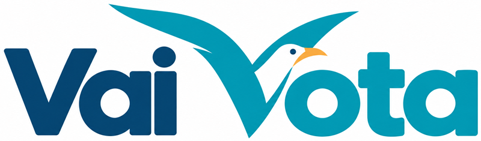
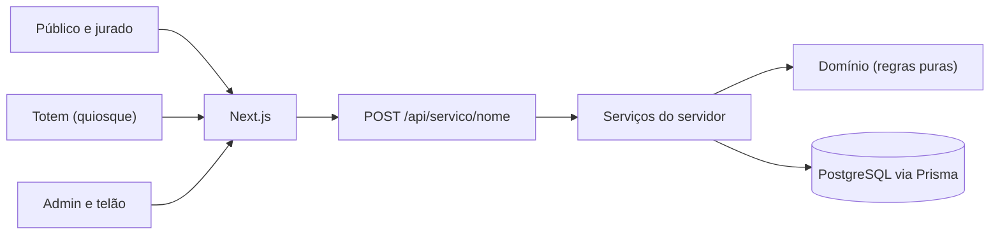

<p align="center"></p>

# VaiVota

Plataforma web **white-label de votação para eventos**. Um mesmo software atende festivais, torneios e campeonatos: cada evento tem seus candidatos, regras e identidade visual, sem alterar código.

> **Status (novembro de 2026):** a **Maratona Tech Tivit** já usou o sistema com dados reais. O próximo evento é o **9º Festival Ver e Fazer Filmes** (25 a 28/11/2026). Júri, voto infantil nos totens, parceiros e telão já funcionam com o servidor real, e o evento foi criado pelo seed, em rascunho. Falta preparar o evento (admin, curtas, convites do júri e totens), fechar as [decisões pendentes](docs/DECISOES-PENDENTES.md) e conferir telão e totem no navegador. Depois do Festival vem a fase Final, com escopo proposto em [`fase4.md`](fase4.md).

---

## Sumário

- [O que é](#o-que-é)
- [Eventos](#eventos)
- [Recursos](#recursos)
- [Conceitos](#conceitos)
- [Princípios de design](#princípios-de-design)
- [Stack](#stack)
- [Arquitetura](#arquitetura)
- [Rotas](#rotas)
- [Modelo de dados](#modelo-de-dados)
- [Primeiros passos](#primeiros-passos)
- [Comandos](#comandos)
- [Variáveis de ambiente](#variáveis-de-ambiente)
- [Implantação e operação](#implantação-e-operação)
- [Estrutura do projeto](#estrutura-do-projeto)
- [Segurança e privacidade](#segurança-e-privacidade)
- [Documentação](#documentação)
- [Roadmap](#roadmap)
- [Licença](#licença)

## O que é

O VaiVota resolve o ciclo completo de uma votação presencial e online: o público vota pelo celular (por QR Code), jurados votam em um painel próprio, crianças votam em totens, e a organização acompanha tudo, apresenta o resultado em um telão e exporta os dados.

O produto é **configurável, não customizável**: o layout e os fluxos são fixos, e cada evento muda nome, logo, cores, tipografia, rótulos e regras por configuração. O VaiVota aparece de forma discreta e o evento é o dono da experiência.

## Eventos

| Evento | Slug | Quando | Módulos | Situação |
|---|---|---|---|---|
| Maratona Tech Tivit | `maratona-tech-tivit` | Outubro de 2026, um dia | Só voto popular, 8 projetos ([plano](MVP-MaratonaTechTivit.md)) | Realizado |
| 9º Festival Ver e Fazer Filmes | `ver-e-fazer-filmes` | 25/11 10h a 28/11 20h de 2026 | Popular, júri (4 critérios) e infantil; parceiros e telão. Pesos provisórios 50/30/20 | Em preparação |

Os dois eventos são criados por seed (`pnpm db:seed` e `pnpm db:seed:festival`). Não há painel de super admin: eventos e o primeiro admin vêm de seed e script.

## Recursos

| Recurso | Descrição |
|---|---|
| **Votação popular** | Login com e-mail e senha (com **código por e-mail** para confirmar a conta e recuperar a senha) ou Google; lista de candidatos, revisão e confirmação. Um voto por pessoa, irrevogável e sigiloso. Ordem dos candidatos aleatória ou alfabética |
| **Votação do júri** | Convites individuais de uso único, gerados pelo admin; voto identificado para o admin e alterável enquanto a urna estiver aberta. Três formas, escolhidas pelo admin: **voto único** (um candidato), **notas por critério** (0 a 10 por candidato em cada critério; placar = média simples) e **melhor por critério** (um candidato por critério; cada escolha vale 1 voto). O público sempre vota em um só |
| **Votação infantil** | Totens pareados por código de uso único, em modo quiosque com PIN de saída, sem login e sem dados pessoais. O admin pausa, reativa, renomeia e revoga cada aparelho |
| **Modo apresentação** | Sala de controle e telão em abas separadas, comandados por um controle remoto: andamento ao vivo, QR Code, trailer (link do YouTube ou Vimeo, ou gerado), revelação do resultado com categorias, pódio e empates, e ensaio com resultado inventado |
| **Parceiros** | Logos dos parceiros na página do evento e no telão |
| **Dashboard** | Acompanhamento da operação (aba Operação) e resultado oficial (aba Resultado), com exportação em CSV e relatório imprimível |
| **Configuração do evento** | Seções Geral, Itens (candidatos e campos extras), Júri, Totens, Placar (pesos e desempate), Tema, Parceiros e Operação (checklist, urna, conclusão) |
| **Multi-evento** | Vários eventos isolados no mesmo sistema, cada um em `/e/{slug}`. A landing `/` leva aos eventos em andamento e mostra as votações concluídas (participantes, votos e vencedor) |
| **Retenção de dados** | Anonimização dos participantes depois do prazo do evento (90 dias por padrão) |

Os módulos de júri e infantil são opcionais por evento e ligados em Configuração > Júri e > Totens.

## Conceitos

- **Evento:** uma votação com seus candidatos, regras, tema e participantes.
- **Candidato:** o item votado (filme, projeto, música, jogo). O título é fixo; descrição e outros dados são campos extras configuráveis pelo evento. A imagem é obrigatória para publicar.
- **Urna:** controla quando se pode votar (`NAO_INICIADA`, `ABERTA`, `ENCERRADA`). Abre e fecha só pela organização.
- **Participação:** vínculo de um usuário com um evento, com papel (`PUBLICO`, `JURADO`, `ADMIN`).
- **Placar:** contagem de votos de um grupo (popular, júri ou infantil).
- **Pontuação final:** resultado da fórmula ponderada que define o ranking.
- **Resultado oficial:** cálculo congelado no encerramento da urna; fonte única do telão, do dashboard e da exportação.
- **Totem:** aparelho pareado com o evento para o voto infantil.
- **Parceiro:** apoiador do evento, com nome e logo.

### Apuração

```
pontuação(candidato) =
    peso_popular   × (votos_populares ÷ total_popular)
  + peso_juri      × (votos_juri      ÷ total_juri)
  + peso_infantil  × (votos_infantis  ÷ total_infantil)
```

Cada grupo é normalizado antes de receber o peso; os pesos somam 100% e são configuráveis por evento. O desempate também é configurável (maior votação do júri ou do público). No júri por critério, `votos_juri` vem do modo ativo: a média das notas ou as escolhas por critério.

## Princípios de design

1. **Integridade primeiro:** nenhum voto válido duplicado, perdido ou alterado indevidamente.
2. **Sigilo proporcional ao grupo:** voto popular secreto, voto do júri identificado para o admin, voto infantil sem identidade.
3. **Simples para votar:** poucos passos, feedback claro, mobile-first.
4. **Configurável, não customizável:** tema e regras por evento, sem editor visual.
5. **Escopo enxuto:** sem recursos sociais, curtidas ou gamificação.

## Stack

| Camada | Tecnologia |
|---|---|
| Framework | Next.js 16 (App Router, React Compiler), React 19, TypeScript |
| Estilo | Tailwind CSS 4 e variáveis de tema por evento |
| Banco de dados | PostgreSQL (Supabase) |
| ORM e migrações | Prisma 7 (adaptador `pg`) |
| Autenticação | Better Auth: e-mail e senha com código por e-mail e Google |
| E-mail | Resend (plano B: SMTP com Nodemailer) |
| Imagens | Supabase Storage |
| Validação | Zod |
| Testes | Vitest; PostgreSQL embutido (`embedded-postgres`) na integração; k6 na carga |
| Hospedagem e monitoramento | Vercel e Sentry (opcional) |

## Arquitetura

O sistema tem quatro experiências sobre os mesmos dados e regras de negócio, e o servidor valida tudo.



| Camada | Onde | O que faz |
|---|---|---|
| Domínio | `src/dominio/**` | Regras puras: apuração, travas por fase, checklist, roteiro e motor do palco, exportação, auditoria. O mesmo código roda no navegador e no servidor |
| Servidor | `src/server/**` | Serviços chamados por `POST /api/servico/<nome>` (`src/server/rpc.ts`): valida os argumentos (Zod), resolve a sessão pelo cookie e revalida papel e fase a cada chamada |
| Cliente | `src/servicos/**` | Funções com as mesmas assinaturas do protótipo, que chamam o servidor e devolvem `Resultado<T>` |
| Estado público | `src/server/estadoPublico.ts` → `src/store/estadoReal.ts` | O layout raiz entrega evento, tema, candidatos publicados, parceiros e a própria pessoa; o navegador renova por polling (10 s esperando a urna, 30 s depois de votar, 60 s com a urna encerrada). Nunca chegam votos, auditoria nem e-mails de terceiros |

O que passa por onde, serviço a serviço, está em [`docs/FRONTEIRA-DADOS.md`](docs/FRONTEIRA-DADOS.md).

### Decisões de arquitetura

- **Multi-evento:** todo dado de domínio carrega o evento; um admin só acessa o seu.
- **Tema por variáveis de design:** cores, tipografia e rótulos vêm da configuração do evento.
- **Resultado congelado:** gerado no encerramento da urna e versionado; correções criam uma nova versão.
- **Voto único no banco:** `UPDATE ... WHERE votou = false` e `INSERT` do voto na mesma transação, com a linha do evento travada (`FOR SHARE`): o encerramento espera os votos em andamento e nenhum voto entra depois dele. Júri e totem seguem a mesma trava.
- **Totem sem login:** a identidade do aparelho é um token no cookie `vaivota_totem` (HttpOnly); só o SHA-256 vai ao banco e o cliente nunca envia o id do aparelho. Cada tentativa de voto leva uma chave (`idEnvio`), então o "tentar de novo" não conta o voto duas vezes.
- **Telão no navegador do admin:** o servidor entrega o resultado oficial, o ao vivo e o ensaio; a revelação (cena, passo, pausa) fica no navegador, espelhada entre as abas do mesmo navegador (BroadcastChannel e `localStorage`). O controle remoto não funciona entre aparelhos diferentes.
- **Módulos do Festival por flag:** júri, totem, parceiros, telão e a galeria `/dev/ui` só existem com `NEXT_PUBLIC_MODULOS_FESTIVAL=true` (embutida no build); desligada, essas rotas dão 404 e os atalhos somem.

## Rotas

| Rota | Quem | Tela |
|---|---|---|
| `/` | Todos | Landing do VaiVota (`src/app/(plataforma)/page.tsx`): demonstração do voto, eventos com votação aberta ou por abrir, números das votações encerradas, vencedor das concluídas (ver `docs/FRONTEIRA-DADOS.md`) e a vitrine "A cara do seu evento", que veste a página com o tema de cada votação que já aconteceu. Prévia de compartilhamento própria (`opengraph-image.tsx`), que não desce para as páginas dos eventos. Com `EVENTO_PADRAO_SLUG`, leva direto ao evento |
| `/e/{slug}` | Todos | Entrada do evento: status, acesso (entrar ou criar conta), como funciona e a votação (lista, revisão e confirmação). Visitante vê a lista e entra para votar |
| `/e/{slug}/verificar-email` | Quem acabou de criar conta | Código do e-mail; é ele que abre a sessão |
| `/e/{slug}/recuperar-senha` | Todos | E-mail → código → senha nova |
| `/e/{slug}/continuar` | Quem entrou com Google | Cria a participação e segue ao destino |
| `/e/{slug}/votar` | — | Redireciona para `/e/{slug}#candidatos` (links antigos) |
| `/e/{slug}/convite` | Logado com e-mail verificado | Resgate do código de convite de jurado |
| `/e/{slug}/avaliar/{candidatoId}` | Jurado | Notas ou escolhas por critério, com a urna aberta |
| `/e/{slug}/admin` | Admin | Dashboard: Operação e Resultado, exportação CSV |
| `/e/{slug}/admin/configuracao` | Admin | Configuração do evento |
| `/e/{slug}/admin/relatorio` | Admin | Relatório imprimível (só com resultado oficial) |
| `/e/{slug}/admin/apresentar` | Admin | Sala de controle do telão (real e ensaio). **Apresentar** abre o palco numa aba própria |
| `/e/{slug}/admin/apresentar/palco` | Admin | Palco do telão, comandado pelo controle remoto que flutua nas telas do admin |
| `/e/{slug}/totem/parear` | Aparelho | Pareamento do totem com o código gerado pelo admin |
| `/e/{slug}/totem` | Aparelho | Quiosque do voto infantil |
| `/dev/ui` | Desenvolvimento | Galeria de componentes nos dois temas |
| `POST /api/servico/[nome]` | — | Todos os serviços (exige `Origin` do próprio site) |
| `/api/auth/*` | — | Better Auth: sessão, saída e Google. Cadastro, login por e-mail e códigos passam pelos serviços, que têm bloqueio e auditoria |
| `POST /api/candidatos/imagem` | Admin | Upload de imagens de candidatos e logos de parceiros |

A matriz de rotas por papel e fase está em [`docs/MATRIZ-ROTAS.md`](docs/MATRIZ-ROTAS.md). Navegação interna só com `next/link` (ou o `Botao` com `href`) e `useRouter`.

## Modelo de dados

O schema completo está em [`prisma/schema.prisma`](prisma/schema.prisma) e as migrações (com os CHECKs que o Prisma não expressa) em [`prisma/migrations/`](prisma/migrations/). Todas as migrações são aditivas. Principais pontos:

- **Voto popular sem usuário:** a tabela `voto` não referencia o usuário; `participacao` guarda apenas se a pessoa votou, sem horário.
- **FKs compostas `(id, evento_id)`:** votos só apontam para candidato, participação ou dispositivo do mesmo evento.
- **Votos e históricos nunca são apagados:** dados pessoais são anonimizados, não excluídos.
- **Códigos e tokens:** apenas o hash fica no banco (convites, pareamento, token e PIN do totem).
- **Voto infantil:** `voto_infantil.id_envio` com índice único por dispositivo, para o reenvio ser idempotente.
- **CHECKs** (pesos somam 100; candidato publicado tem imagem): ficam na migração SQL, não no schema do Prisma.

## Primeiros passos

### Pré-requisitos

- Node.js 20.19+ e pnpm
- Para o banco: nada em desenvolvimento (`pnpm db:local` sobe um PostgreSQL embutido) ou um projeto Supabase em produção

### Desenvolvimento

```bash
pnpm install
pnpm db:local                          # PostgreSQL embutido + migrações + seed da Maratona (deixe rodando)
cp .env.example .env.local             # preencha DATABASE_URL, DIRECT_URL, BETTER_AUTH_SECRET e APP_URL; EMAIL_PROVIDER=console
pnpm db:promover-admin seu@email.com   # o primeiro admin
pnpm dev                               # http://localhost:3000/e/maratona-tech-tivit
```

Com `EMAIL_PROVIDER=console`, os códigos de e-mail saem no log do servidor. Sem `SUPABASE_URL`, use `STORAGE_PROVIDER=local` para gravar as imagens em `public/uploads`.

### Festival

```bash
# em .env.local: NEXT_PUBLIC_MODULOS_FESTIVAL=true
pnpm db:seed:festival                                        # cria ver-e-fazer-filmes em rascunho (--trailer <link> opcional)
pnpm db:promover-admin seu@email.com --slug ver-e-fazer-filmes
pnpm dev                                                     # http://localhost:3000/e/ver-e-fazer-filmes
```

O seed do Festival liga júri e infantil, aplica o tema do festival, os quatro critérios do júri e os parceiros de `public/parceiros`. Parceiros e critérios só entram na criação do evento: rodar de novo não altera nada.

## Comandos

| Comando | Para quê |
|---|---|
| `pnpm dev` · `pnpm build` · `pnpm start` | Servidor de desenvolvimento, build e produção |
| `pnpm lint` · `pnpm typecheck` | ESLint e `next typegen` + `tsc --noEmit` |
| `pnpm test` | Testes unitários (domínio, lib, estado real, cliente do servidor) |
| `pnpm test:integracao` | Servidor contra um PostgreSQL **real** embutido: voto único com concorrência, encerramento durante rajada, login, operação, painel, júri, totem, telão, seed, anonimização e segurança |
| `pnpm db:local` | PostgreSQL embutido com migrações e seed (`--resetar` recomeça do zero) |
| `pnpm db:migrar` | Aplica as migrações (`prisma migrate deploy`) |
| `pnpm db:seed` · `pnpm db:seed:festival` | Cria a Maratona ou o Festival (idempotente) |
| `pnpm db:promover-admin <e-mail> [--slug <evento>]` | Torna admin quem já tem conta, ou cria um convite de admin |
| `pnpm db:backup --rotulo antes-da-urna` | Backup com `pg_dump` |
| `pnpm db:limpar-ensaio --confirmar` | Limpa os dados do ensaio antes do evento |
| `pnpm db:anonimizar [--executar]` | Anonimização dos eventos vencidos (sem `--executar`, só simula) |
| `pnpm db:carga-preparar` · `k6 run tests/carga/votar.js` · `pnpm db:carga-conferir` | Teste de carga e conferência de integridade |

## Variáveis de ambiente

Todas estão comentadas em [`.env.example`](.env.example). Segredos nunca vão em variáveis `NEXT_PUBLIC_*`.

| Grupo | Variáveis |
|---|---|
| Banco | `DATABASE_URL` (pooler do Supabase), `DIRECT_URL` (migração e backup), `DB_POOL_MAX` |
| Site e autenticação | `APP_URL`, `BETTER_AUTH_SECRET`, `TRUSTED_ORIGINS`, `EVENTO_PADRAO_SLUG`, `CONTATO_ORGANIZADORES_URL` (botão de contato da landing, opcional), `GOOGLE_CLIENT_ID`/`GOOGLE_CLIENT_SECRET` |
| E-mail | `EMAIL_PROVIDER` (`resend`, `smtp` ou `console`), `RESEND_API_KEY`, `EMAIL_FROM`, `SMTP_*` |
| Imagens | `SUPABASE_URL` (também no build), `SUPABASE_SERVICE_ROLE_KEY`, `SUPABASE_STORAGE_BUCKET`, `STORAGE_PROVIDER` |
| Seed | `SEED_SLUG`, `SEED_NOME`, `SEED_JANELA_INICIO`, `SEED_JANELA_FIM`, `SEED_TRAILER_URL`, `IP_HASH_SALT` |
| Monitoramento | `SENTRY_DSN`, `NEXT_PUBLIC_SENTRY_DSN` |
| Festival | `NEXT_PUBLIC_MODULOS_FESTIVAL` (embutida no build) |

## Implantação e operação

- Supabase, Vercel, domínio, Resend e Google: [`docs/MARATONA-TECH-TIVIT-IMPLANTACAO.md`](docs/MARATONA-TECH-TIVIT-IMPLANTACAO.md).
- Dia do evento e contingência: [`docs/MARATONA-TECH-TIVIT-DIA-DO-EVENTO.md`](docs/MARATONA-TECH-TIVIT-DIA-DO-EVENTO.md).
- Código que lê uma coluna nova quebra as páginas até a migração rodar: aplique `pnpm db:migrar` antes de publicar uma mudança de schema.

## Estrutura do projeto

```
vaivota/
├── prisma/
│   ├── schema.prisma
│   └── migrations/          # SQL das migrações, com os CHECKs
├── scripts/                 # seed, promover-admin, backup, limpar-ensaio, anonimizar, banco local, carga
├── src/
│   ├── app/                 # rotas (App Router): /, /e/[slug], /api/servico/[nome], /api/auth, /api/candidatos/imagem
│   ├── components/          # interface por área (evento, votacao, config, dashboard, apresentacao, totem, plataforma...)
│   ├── dominio/             # regras puras, compartilhadas entre navegador e servidor
│   ├── servicos/            # cliente: chamam o servidor com as assinaturas do protótipo
│   ├── server/              # servidor: Prisma, Better Auth, voto, júri, totem, telão, painel, exportação, upload
│   ├── store/               # estado do navegador (estado público do servidor e estado de tela)
│   ├── lib/                 # tempo, formatação, CSV, tema, flags
│   └── mocks/               # dados do protótipo (usados pelos testes)
├── tests/
│   ├── integracao/          # PostgreSQL real embutido
│   └── carga/               # k6
├── public/                  # logos, parceiros do Festival
├── docs/                    # implantação, fronteira de dados, rotas, decisões, achados
└── planners/                # especificações por módulo (Base/) e planners das etapas da Fase 1
```

## Segurança e privacidade

- Validações **sempre no servidor** (estado da urna, papel, unicidade, dispositivo).
- Rate limiting em login, registro, resgate de código, pareamento, PIN do totem e voto.
- Códigos de convite, códigos de pareamento, tokens de dispositivo e PINs guardados apenas como **hash**.
- Resultado e votos identificados disponíveis só para o admin autenticado, e só depois do encerramento.
- **Auditoria** de ações administrativas, convites, dispositivos, alterações de voto do júri, bloqueios, exportações e anonimização, separada dos logs técnicos.
- **Privacidade (LGPD):** coleta mínima (nome e e-mail); exportações trazem só contagens de participantes. Depois de `prazoAnonimizacaoDias` (90 por padrão) de um evento concluído, quem só participou dele tem nome e e-mail trocados por valores neutros e a conta de login apagada; ficam a participação, os votos e a auditoria. Roda em lotes na manutenção do servidor e à mão por `pnpm db:anonimizar`. Administradores ficam de fora, salvo `--incluir-admins`.
- O voto do jurado é identificado para o admin, e o jurado é informado disso no registro.
- O voto infantil não guarda dado da criança: a chave de envio só evita contar o mesmo voto duas vezes.

## Documentação

| Documento | Conteúdo |
|---|---|
| [`DocumentDesign.md`](DocumentDesign.md) | Design Document completo: escopo, arquitetura, modelo de dados, regras, segurança, plano de entrega, riscos e pendências |
| [`MVP-MaratonaTechTivit.md`](MVP-MaratonaTechTivit.md) | Plano do MVP da Maratona Tech Tivit |
| [`fase4.md`](fase4.md) | Escopo proposto da fase Final, para decisão |
| [`docs/FRONTEIRA-DADOS.md`](docs/FRONTEIRA-DADOS.md) | Cada serviço, onde roda no servidor e o que o cliente nunca recebe |
| [`docs/MATRIZ-ROTAS.md`](docs/MATRIZ-ROTAS.md) | Rotas por papel e telas por fase |
| [`docs/DECISOES-PENDENTES.md`](docs/DECISOES-PENDENTES.md) | Decisões que continuam com o dono do produto |
| [`docs/ACHADOS.md`](docs/ACHADOS.md) | Achados da revisão e o que ficou em aberto |
| [`docs/ROTEIRO-DEMO.md`](docs/ROTEIRO-DEMO.md) | Roteiro da demonstração do Festival (protótipo) |
| [`planners/Base/`](planners/Base/) | Especificações: [Login](planners/Base/Login.md), [Júri](planners/Base/Jurado.md), [Voto infantil](planners/Base/VotoInfantil.md), [Modo apresentação](planners/Base/ModoApresentacao.md), [Dashboard](planners/Base/Dashboard.md) |

## Roadmap

| Fase | Quando | Situação |
|---|---|---|
| **1. Demonstração** | 09/10/2026 | Concluída: protótipo navegável com dados em memória, no tema do Festival |
| **2. Maratona Tech Tivit** | Outubro de 2026 | Concluída: trilha de produção (banco, autenticação, upload, voto, operação, apuração, painel, exportação), carga e uso real |
| **3. Festival** | 25 a 28/11/2026 | Em preparação: júri, totem, parceiros, telão e anonimização prontos no servidor |
| **4. Final** | Depois do Festival | Escopo proposto em [`fase4.md`](fase4.md): tela de apresentação, vínculo entre candidato e usuário, encerramento automático, página pública de resultado, convite de admin, super admin, duplicar evento e limpeza do protótipo |

**Fora do escopo por ora:** painel de super admin, controle remoto do telão entre aparelhos diferentes, revelação por critério do júri no telão, peso e desempate por critério, fila offline nos totens, upload de vídeo, geração de PDF no servidor e duplicar configuração entre eventos.

### Sobre o protótipo da Fase 1

O protótipo da demonstração rodava só no navegador, com relógio simulado, contas seed e uma toolbar de desenvolvimento para forçar estados. A trilha de produção manteve as assinaturas dos serviços e os seletores, então as telas são as mesmas. A toolbar não é mais montada; `src/mocks` e parte de `src/store` continuam no repositório porque os testes de domínio os usam, e a remoção está prevista na fase Final.

## Licença

A definir.
